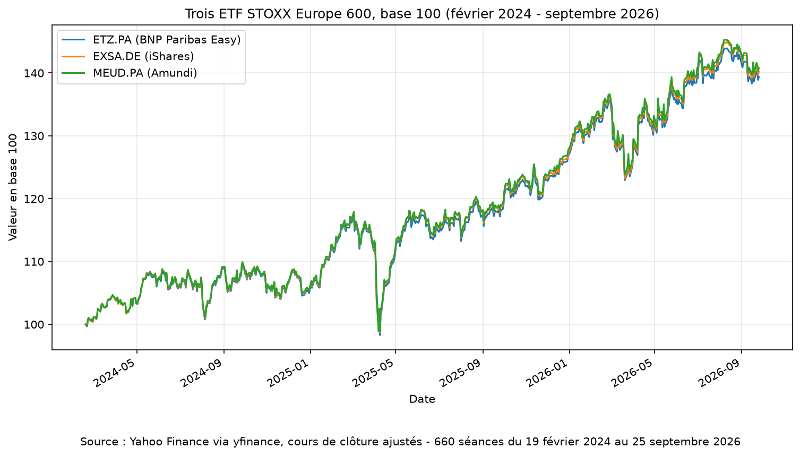
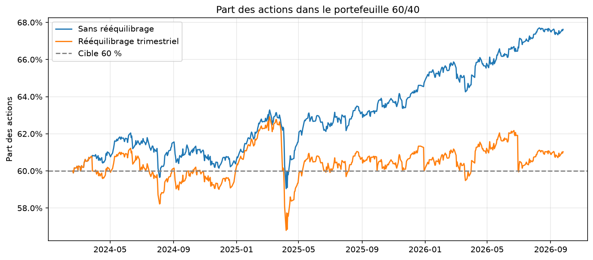
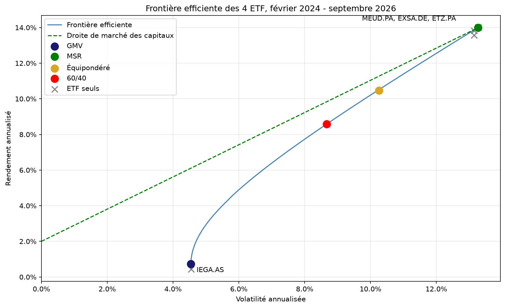

# Python finance basics

*Version française : [README.md](README.md)*

Market data analysis in Python, carried out from September to November 2026 while preparing for a work-study position in asset management. The repository holds two complete projects, learning notebooks and a module of reusable functions. Notebooks are written in French; code comments are in English.

## Projects

### [Three ETFs, one index: which one to pick?](projets/projet1_etf_stoxx600.ipynb)

Three ETFs track the STOXX Europe 600: MEUD.PA (Amundi), EXSA.DE (iShares) and ETZ.PA (BNP Paribas Easy). Which one should an investor hold, and do fees account for the performance gaps?



| ETF | Ongoing charges | Cumulative return | Volatility | Max drawdown | Gap not explained by fees |
|---|---|---|---|---|---|
| MEUD.PA | 0.07% | 40.81% | 13.26% | −16.18% | benchmark |
| EXSA.DE | 0.20% | 40.25% | 13.12% | −16.33% | 0.22 pt |
| ETZ.PA | 0.19% | 39.43% | 13.12% | −16.28% | 1.07 pt |

*660 trading days, 19 February 2024 to 25 September 2026.*

**Answer:** MEUD.PA, with the same risk as the other two and the lowest fees. Fees account for almost all of EXSA.DE's gap. ETZ.PA, the only synthetic (swap-based) fund, leaves 1.07 points unexplained, lost steadily over time: a swap cost is the most plausible explanation, which this data cannot prove.

### [Should a 60/40 portfolio be rebalanced?](projets/projet2_portefeuille_60_40.ipynb)

A 60% equity (MEUD.PA) / 40% bond (IEGA.AS) portfolio, either left untouched or brought back to its target weights every quarter.



| | Cumulative return | Annualized return | Volatility | Max drawdown | Sharpe (2%) |
|---|---|---|---|---|---|
| Buy and hold | 24.93% | 8.95% | 8.95% | −10.56% | 0.78 |
| Quarterly rebalancing | 23.70% | 8.53% | 8.65% | −10.29% | 0.75 |

**Answer:** left alone, the equity share drifts up to 67.6% and the portfolio ends up riskier than intended. Rebalancing keeps it between 57% and 63%, at a cost of 0.42 point of annualized return over a rising equity market. Sitting on the efficient frontier of the four ETFs, the 60/40 is a sound choice of risk level, and more robust than the optimized portfolio.

## Also worth a look

**[Efficient frontier on four ETFs](apprentissage/08_frontiere_efficiente.ipynb).** Global minimum variance and maximum Sharpe ratio portfolios, and where a 60/40 sits. Lowering one ETF's expected return by 0.5 point is enough to flip the maximum Sharpe portfolio from 90% MEUD.PA to 100% EXSA.DE.



## Learning notebooks

| Notebook | Content |
|---|---|
| [01 – Daily returns](apprentissage/01_rendements_journaliers.ipynb) | Daily return of one stock, best and worst session |
| [02 – Returns by ticker](apprentissage/02_rendements_par_titre.ipynb) | Returns per ticker from a multi-stock file |
| [03 – Reading a market CSV](apprentissage/03_lecture_csv_bourse.ipynb) | Real price history, missing data handling |
| [04 – Comparing three ETFs](apprentissage/04_comparaison_etf_europe.ipynb) | Three STOXX Europe 600 ETFs rebased to 100, performance gap against fee gap |
| [05 – Risk measures](apprentissage/05_indicateurs_risque.ipynb) | Annualized return and volatility, return distribution, maximum drawdown |
| [06 – Sharpe ratio and correlations](apprentissage/06_sharpe_correlations.ipynb) | Sharpe ratio under three rate assumptions, correlations, adding a bond fund |
| 07 – 60/40 portfolio | Became [project 2](projets/projet2_portefeuille_60_40.ipynb) |
| [08 – Efficient frontier](apprentissage/08_frontiere_efficiente.ipynb) | GMV, MSR, equal weight, 60/40, sensitivity to estimation error |

## Module `outils_portefeuille.py`

Functions written along the notebooks, gathered in one file: annualized return and volatility, Sharpe ratio, drawdown, tracking error, summary table, portfolio construction (GMV, MSR, efficient frontier).

```python
import sys
sys.path.append("..")
from outils_portefeuille import *
```

## Data

- `data/etf_europe.csv`: adjusted closing prices of MEUD.PA, ETZ.PA and EXSA.DE, downloaded with yfinance at the end of September 2026 and frozen.
- `data/actions_obligations.csv`: the three equity ETFs and IEGA.AS (iShares Core € Govt Bond), 659 common sessions.
- `data/aapl_us_d.csv`: Apple daily history since 1984 (source: stooq.com).
- `data/prix.txt` and `data/cotations.txt`: exercise files.

## Environment

Python 3 with `pandas`, `matplotlib`, `seaborn` (06, project 2), `scipy` (08 and module) and `yfinance` (04). Notebooks 01 to 03 need no installation. Paths are relative: run each notebook from its own folder. Notebook 04 downloads fresh data and overwrites `data/etf_europe.csv`; do not rerun it if you want the published figures.

The optimisation methods in notebook 08 draw on the course *Introduction to Portfolio Construction and Analysis with Python* (EDHEC Business School, Coursera).

Author: KOULEKPOTO Yao Eloge Crédo
