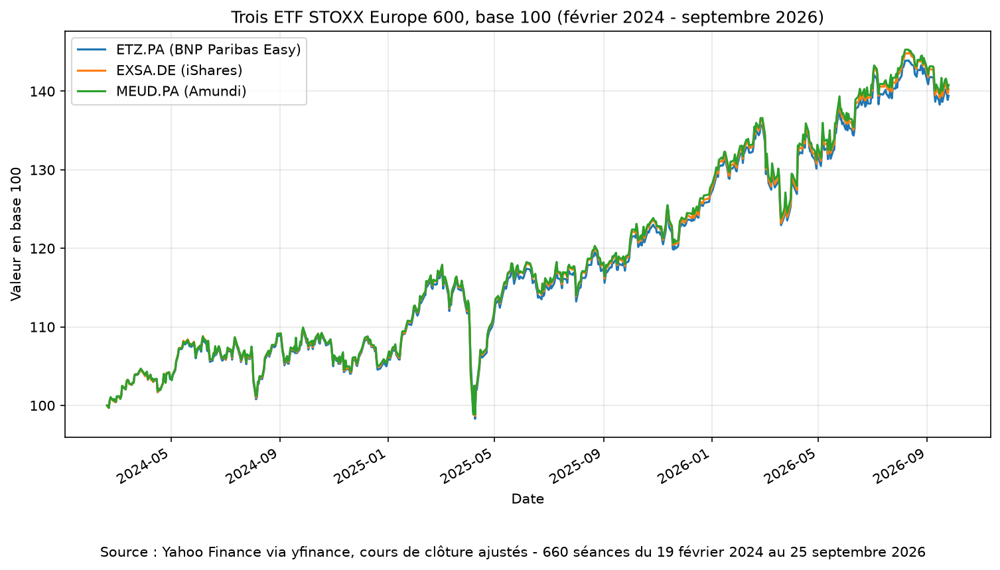
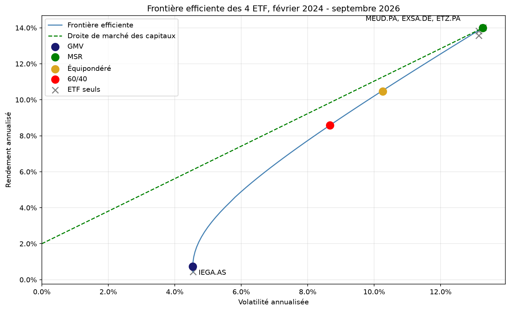
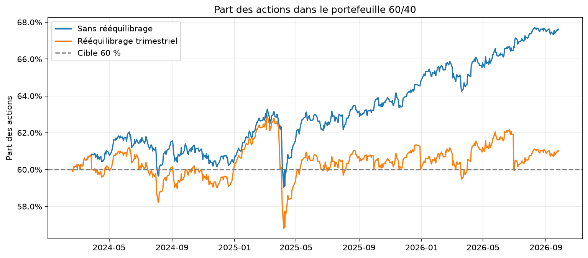

# Python finance basics

*English version: [README.en.md](README.en.md)*

Analyse de données de marché en Python, réalisée de septembre à novembre 2026 pour préparer une alternance en gestion d'actifs. Le dépôt contient un projet complet, huit notebooks d'apprentissage et un module de fonctions réutilisables.

## Projet

### [Trois ETF pour un même indice : lequel choisir ?](projets/projet1_etf_stoxx600.ipynb)

Trois ETF répliquent le STOXX Europe 600 : MEUD.PA (Amundi), EXSA.DE (iShares) et ETZ.PA (BNP Paribas Easy). Lequel retenir, et les écarts de performance s'expliquent-ils par les frais ?



| ETF | Frais courants | Performance cumulée | Volatilité | Max drawdown | Écart non expliqué par les frais |
|---|---|---|---|---|---|
| MEUD.PA | 0,07 % | 40,81 % | 13,26 % | −16,18 % | référence |
| EXSA.DE | 0,20 % | 40,25 % | 13,12 % | −16,33 % | 0,22 pt |
| ETZ.PA | 0,19 % | 39,43 % | 13,12 % | −16,28 % | 1,07 pt |

*660 séances, du 19 février 2024 au 25 septembre 2026.*

**Réponse :** MEUD.PA, pour un risque identique et les frais les plus bas. L'écart d'EXSA.DE vient presque entièrement de ses frais. Celui d'ETZ.PA, seul fonds à réplication synthétique, laisse 1,07 point inexpliqué, perdu de façon régulière : un coût de swap est l'hypothèse la plus plausible, que ces données ne suffisent pas à prouver.

## À voir aussi

**[Frontière efficiente sur quatre ETF](apprentissage/08_frontiere_efficiente.ipynb).** Portefeuilles de variance minimale et de Sharpe maximal, position d'un 60/40. Une baisse de 0,5 point du rendement attendu d'un seul ETF suffit à faire basculer le portefeuille de Sharpe maximal de 90 % MEUD.PA à 100 % EXSA.DE.



**[Portefeuille 60/40 avec et sans rééquilibrage](apprentissage/07_portefeuille_60_40.ipynb).** Dérive des poids en buy and hold face à un rééquilibrage trimestriel.



## Notebooks d'apprentissage

| Notebook | Contenu |
|---|---|
| [01 – Rendements journaliers](apprentissage/01_rendements_journaliers.ipynb) | Rendement quotidien d'un titre, meilleure et pire séance |
| [02 – Rendements par titre](apprentissage/02_rendements_par_titre.ipynb) | Rendements par titre sur un fichier multi-valeurs, tickers découverts à la lecture |
| [03 – Lecture d'un CSV boursier](apprentissage/03_lecture_csv_bourse.ipynb) | Lecture d'un historique CSV réel, gestion des données manquantes |
| [04 – Comparaison de trois ETF](apprentissage/04_comparaison_etf_europe.ipynb) | Trois ETF STOXX Europe 600 comparés en base 100, écart de performance confronté à l'écart de frais |
| [05 – Indicateurs de risque](apprentissage/05_indicateurs_risque.ipynb) | Volatilité et rendement annualisés, distribution des rendements, maximum drawdown |
| [06 – Sharpe et corrélations](apprentissage/06_sharpe_correlations.ipynb) | Ratio de Sharpe sous trois hypothèses de taux, corrélations entre fonds, apport d'une classe obligataire |
| [07 – Portefeuille 60/40](apprentissage/07_portefeuille_60_40.ipynb) | Buy and hold puis rééquilibrage trimestriel : dérive des poids et indicateurs comparés |
| [08 – Frontière efficiente](apprentissage/08_frontiere_efficiente.ipynb) | GMV, MSR, équipondéré, position du 60/40 et fragilité du MSR aux estimations |

Les notebooks 01 à 03 n'utilisent que la bibliothèque standard. Le 04 introduit pandas, yfinance et matplotlib, le 05 approfondit matplotlib, le 06 ajoute seaborn, le 07 construit un portefeuille multi-actifs, le 08 ajoute l'optimisation avec SciPy.

## Module `outils_portefeuille.py`

Fonctions écrites au fil des notebooks et regroupées en un seul fichier : rendement et volatilité annualisés, ratio de Sharpe, drawdown, tracking error, tableau récapitulatif, construction de portefeuille (GMV, MSR, frontière efficiente).

```python
import sys
sys.path.append("..")
from outils_portefeuille import *
```

## Données

- `data/etf_europe.csv` : cours de clôture ajustés de MEUD.PA, ETZ.PA et EXSA.DE, téléchargés via yfinance fin septembre 2026 et figés.
- `data/actions_obligations.csv` : les trois ETF actions et IEGA.AS (iShares Core € Govt Bond), 659 séances communes.
- `data/aapl_us_d.csv` : historique quotidien Apple depuis 1984 (source : stooq.com).
- `data/prix.txt` et `data/cotations.txt` : fichiers d'exercice, formats `date;prix` et `ticker;date;prix`.

## Notions travaillées

- Python de base : lecture de fichiers, dictionnaires, listes, module `csv`, gestion d'erreurs, rendements simples et composés.
- pandas : `read_csv` et index temporel, `dropna`, `pct_change`, `groupby`, `resample`, mise en base 100.
- Indicateurs de risque : volatilité et rendement annualisés, maximum drawdown, ratio de Sharpe, corrélations, tracking error, écart de performance confronté aux frais.
- Construction de portefeuille : allocation 60/40, dérive des poids, rééquilibrage trimestriel.
- Optimisation : frontière efficiente de Markowitz, GMV et MSR, `scipy.optimize`, sensibilité de l'allocation aux erreurs d'estimation.

## Environnement

Python 3 avec `pandas`, `matplotlib`, `seaborn` (06, 07), `scipy` (08 et module) et `yfinance` (04). Les notebooks 01 à 03 s'exécutent sans installation.

Les chemins sont relatifs : chaque notebook s'exécute depuis son propre dossier après clonage du dépôt. Le notebook 04 retélécharge les données et réécrit `data/etf_europe.csv` ; ne le relancez pas si vous voulez retrouver les chiffres publiés.

Les méthodes d'optimisation du notebook 08 s'appuient sur le cours *Introduction to Portfolio Construction and Analysis with Python* (EDHEC Business School, Coursera).

Auteur : KOULEKPOTO Yao Eloge Crédo
